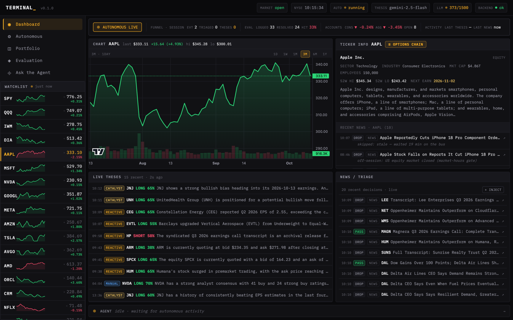
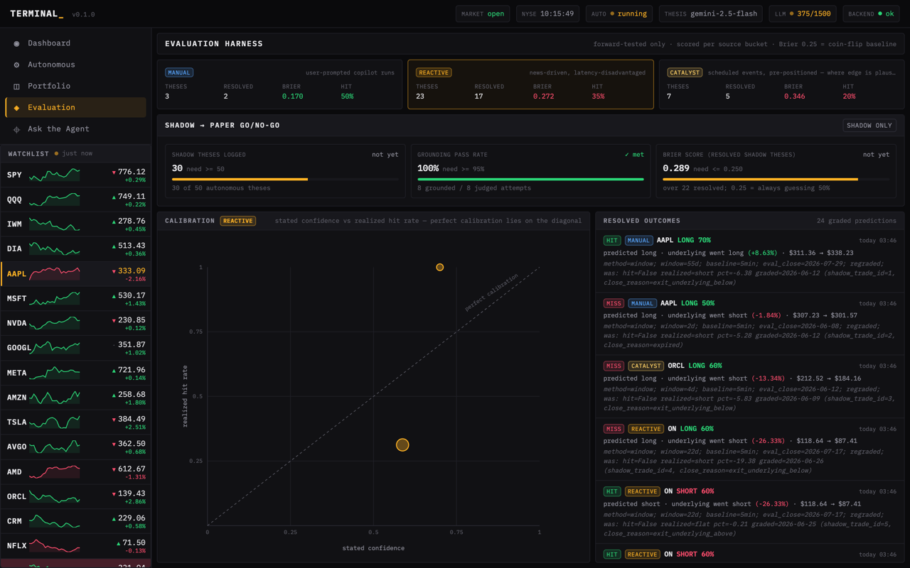
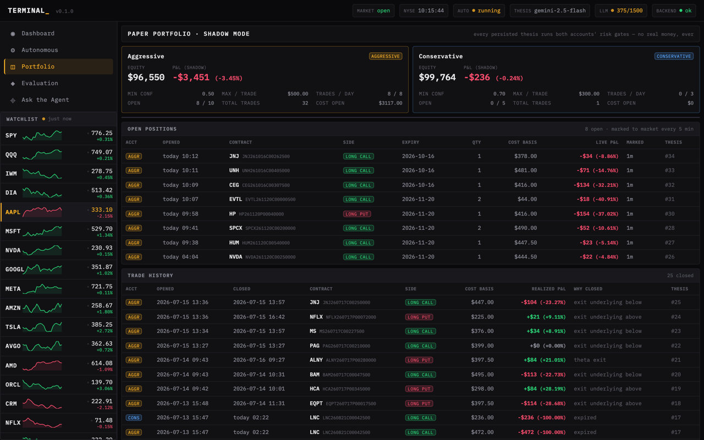
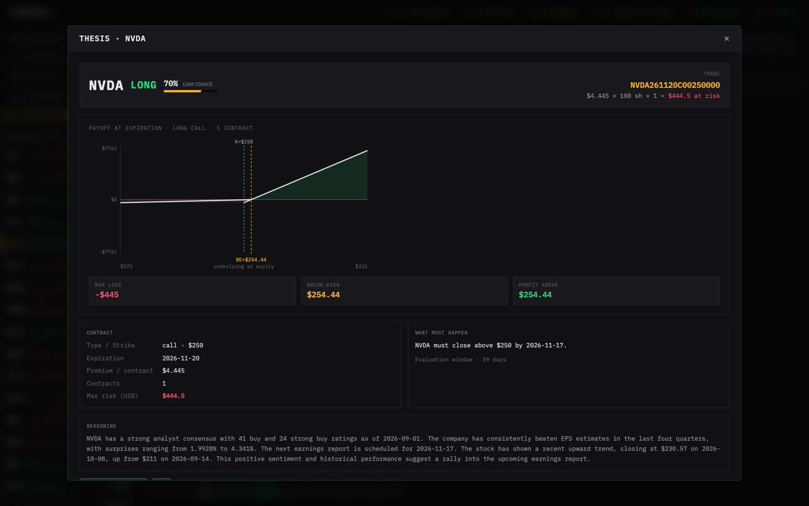
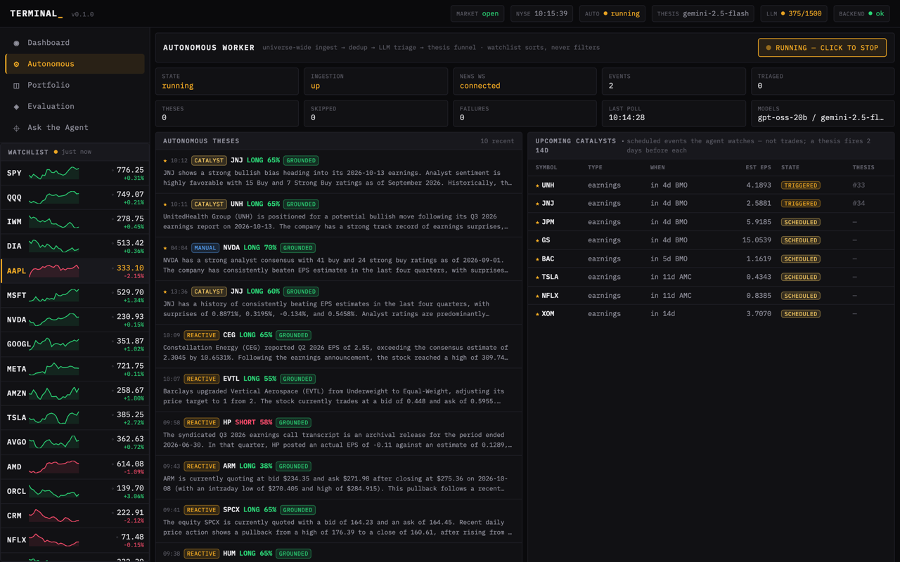
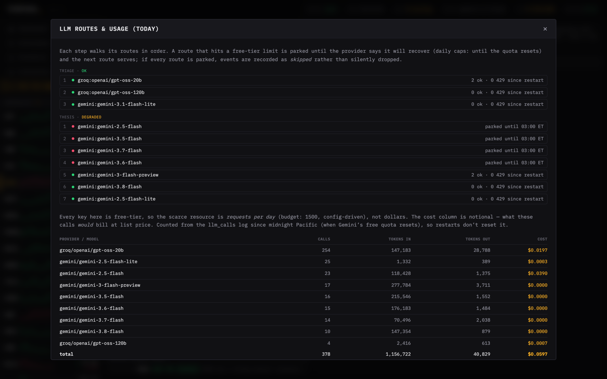
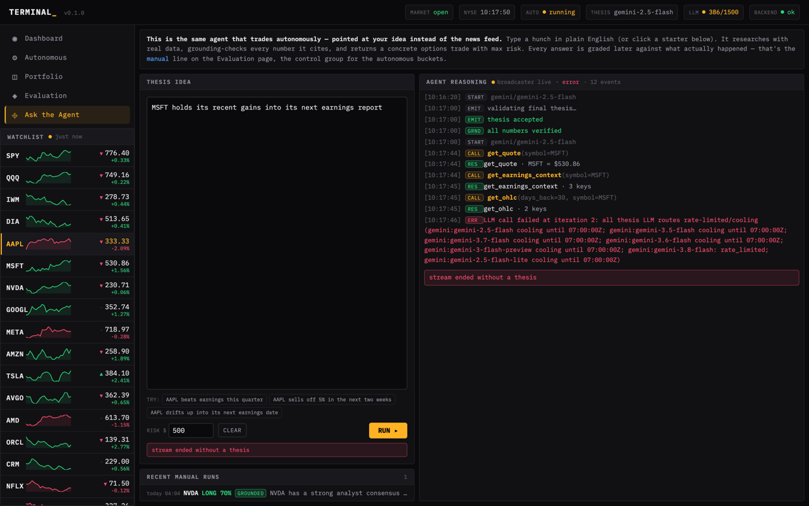
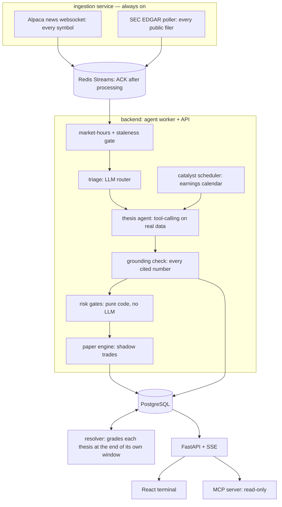

# Terminal

**An always-on AI research terminal that writes options theses on live market news — and then grades every one of them against what the market actually did.**

[](https://github.com/NikhileshThiru/terminal/actions/workflows/ci.yml)     -success)

An AI-native trading research terminal that watches the entire US stock market all day. When something material happens — an 8-K filing, an earnings headline, a scheduled catalyst — a free-tier LLM reads it, researches the stock with real market data, and writes a structured options thesis (direction, contract, max risk, confidence). Deterministic risk rules decide whether it paper-trades. And then the part that makes the project honest: **every prediction is graded against what the market actually did, over the horizon it claimed.**

The project is measured by the **evaluation**, not the P&L.

> **Disclaimer.** This is a paper-trading research project. No real money is ever placed and no live order execution exists, by design. Nothing here is investment advice. All data sources are free tiers, which means delays and gaps; the system is built to degrade gracefully around them.



**[Screens](#the-screens) · [How it works](#how-it-works) · [Tech stack](#tech-stack) · [Results](#results-so-far) · [Status](#status-2026-10-09-finished) · [Run it](#running-locally) · [What I learned](#what-i-learned) · [Design doc](docs/DESIGN.md) · [ADRs](docs/decisions/)**

---

## The screens

<table>
  <tr>
    <td width="50%"><a href="docs/screenshots/final-2026-10/eval.png"></a></td>
    <td width="50%"><a href="docs/screenshots/final-2026-10/portfolio.png"></a></td>
  </tr>
  <tr>
    <td valign="top"><b>Evaluation</b> — per-bucket scorecards, the shadow→paper go/no-go with live progress, the calibration plot (perfect calibration = the diagonal), and every graded prediction with what actually happened — including the pre-correction grade it replaced</td>
    <td valign="top"><b>Portfolio</b> — the conservative-vs-aggressive accounts, open positions marked to market, and closed trades with why they closed and the realized P&amp;L</td>
  </tr>
  <tr>
    <td width="50%"><a href="docs/screenshots/final-2026-10/copilot.png"></a></td>
    <td width="50%"><a href="docs/screenshots/final-2026-10/autonomous.png"></a></td>
  </tr>
  <tr>
    <td valign="top"><b>Ask the Agent</b> — a real run: NVDA long via a contract from the chain the agent fetched, strike and premium verified, max risk inside the budget, payoff at expiration, and a falsifiable "what must happen"</td>
    <td valign="top"><b>Autonomous</b> — ingestion and news-websocket health, visible skips (stale / quota / daily cap), today's theses with grounding badges, and the earnings calendar the catalyst path pre-positions on</td>
  </tr>
  <tr>
    <td width="50%"><a href="docs/screenshots/final-2026-10/llm-routes.png"></a></td>
    <td width="50%"><a href="docs/screenshots/final-2026-10/quota-exhausted.png"></a></td>
  </tr>
  <tr>
    <td valign="top"><b>LLM routes</b> — the failover chains, four thesis models parked on their daily quota until 03:00 ET, and today's per-model usage from the <code>llm_calls</code> log</td>
    <td valign="top"><b>What running out looks like</b> — 10:17 ET on the first live morning: every free thesis model parked, so the run fails fast with the reason instead of hanging or guessing</td>
  </tr>
</table>

A walkthrough of every screen is in [`docs/demo.md`](docs/demo.md). Design language: IBM Plex Mono everywhere; amber = UI state, green/red = market direction only, blue/amber = the two accounts. Evolution for the curious: [pre-redesign, June 11](docs/screenshots/baseline-2026-06-11/dashboard.png) → [redesign, June 12](docs/screenshots/redesign-2026-06-12/dashboard.png) → [today](docs/screenshots/final-2026-10/dashboard.png); the options-chain deep dive: [modal](docs/screenshots/redesign-2026-06-12/chain-modal.png); the early days: [grid v3](docs/screenshots/grid-v3-polished.png), [post-chassis](docs/screenshots/grid-v2-features.png), [first Tailwind](docs/screenshots/grid-v1-empty.png).

---

## How it works



- **Ingestion** is its own always-on container: Alpaca's Benzinga news websocket (every article market-wide), an SEC EDGAR poller (every public filer), dedup in Postgres. It publishes to a **Redis Streams** consumer group; the worker ACKs an event only after processing it, so a restart re-delivers instead of losing it ([ADR-0007](docs/decisions/ADR-0007-redis-streams-and-separate-ingestion.md)). A catalyst calendar of upcoming earnings lets the agent pre-position on known events.
- **Triage** is a cheap LLM gate: "is this material?" Most events drop here, which is what keeps the system inside free quotas. Off-session and stale (backlogged) events are skipped before any LLM call, with a visible reason.
- **Every LLM step runs through a router** that walks an ordered chain of free models, parks any that hit a quota for exactly as long as the provider says, and logs every call to `llm_calls` ([ADR-0006](docs/decisions/ADR-0006-llm-routing-across-free-quotas.md)). Free quotas turned out to be small and *per model* (Gemini ≈ 20 requests/day/model), so the thesis chain spans seven Gemini models; triage runs on Groq.
- **The thesis agent** is a tool-calling loop: it pulls price history, the options chain, fundamentals, and analyst data, then emits a typed, validated thesis object.
- **The grounding check** verifies every number the model cited against the data it actually fetched — born from a real incident where the model fabricated revenue figures and the system happily persisted them. Rejections are logged as attempts, so the pass rate has an honest denominator.
- **Risk and sizing are pure code.** Two paper accounts run the same theses through different deterministic gates — conservative (≥0.70 confidence) vs aggressive (≥0.50) — an A/B test of whether stated confidence carries any signal. Confidence may *filter* which theses an account considers; it never authorizes risk or scales size ([ADR-0003](docs/decisions/ADR-0003-deterministic-risk.md)).
- **The eval harness** grades every thesis — traded or not — over its own prediction window, from the price when it was written to the close at the window's end ([ADR-0008](docs/decisions/ADR-0008-grade-theses-over-their-own-window.md)), and scores three buckets separately: manual / reactive / catalyst ([ADR-0004](docs/decisions/ADR-0004-per-bucket-eval.md)). Hit rate, Brier score, and a calibration plot per bucket. Forward-tested only — backtesting an LLM is meaningless because the model has seen history in training.
- **Shadow → paper go/no-go.** The autonomous agent only logs shadow trades until it clears three bars on its own theses: 50 logged, ≥95% grounding, Brier ≤ 0.25 (the coin-flip baseline). The Eval page reports progress; nothing flips automatically.

Three logical processes (ingestion, agent worker, API) meet only at Postgres and Redis. Full design in [`docs/DESIGN.md`](docs/DESIGN.md); load-bearing decisions in [`docs/decisions/`](docs/decisions/) (eight ADRs); operations in [`docs/runbook.md`](docs/runbook.md).

## Tech stack

| Layer | Choice |
|---|---|
| Backend | Python 3.12 · FastAPI · async SQLAlchemy 2 + Alembic · Pydantic · structlog — uv, ruff, mypy, pytest |
| Storage + bus | PostgreSQL 16 (theses, outcomes, trades, triage log, LLM usage) · Redis 7 Streams (event bus + replay log) |
| LLMs | Gemini + Groq free tiers behind one `LLMProvider` Protocol, composed per step by a quota-aware `LLMRouter` — no paid model anywhere |
| Market data | Alpaca (news websocket, prices, options) · SEC EDGAR · Finnhub · FRED · yfinance fallback — each behind cache + rate limiter + circuit breaker |
| Frontend | React + TypeScript + Vite · Tailwind v4 · lightweight-charts · hand-rolled SVG payoff + calibration charts · SSE streaming — vitest |
| Ops | Docker Compose (5 services) · nginx · GitHub Actions (tests, types, lint, gitleaks, image builds) · Discord alerts · MCP server |

## Results so far

As of 2026-10-09 — forward-tested only, and small samples, so read this as "the measurement works," not "the model has (or lacks) edge":

| Bucket | Theses | Graded | Hit rate | Brier (0.25 = coin flip; lower is better) |
|---|---:|---:|---:|---:|
| Manual — user-prompted ("Ask the Agent") | 3 | 2 | 50% | 0.170 |
| Reactive — news-driven | 23 | 17 | 35% | 0.272 |
| Catalyst — pre-positioned on scheduled earnings | 8 | 5 | 20% | 0.346 |

**Shadow → paper gate:** 31 / 50 autonomous theses · grounding 100% (9 / 9 judged attempts since attempt tracking began) · Brier 0.289 > 0.25 → **stays shadow-only.**

The autonomous agent is currently *worse* than guessing 50%: 20 of the 24 graded theses were bullish, many of them during a falling July, and the sample is far too small to say anything finer. Those grades are honest only since a correction this month — the original resolver graded theses at the moment a stop-loss fired, a selection bias that made misses nearly certain ([ADR-0008](docs/decisions/ADR-0008-grade-theses-over-their-own-window.md); "What I learned" below). The other number worth knowing: the first live morning on the free tier produced 10 theses (6 reactive, 3 catalyst, 1 manual) before **every free thesis model hit its daily cap at 10:17 ET**. On free infrastructure, quota — not the model — is the binding constraint on how fast this eval can learn anything.

## Being honest about edge

This system runs on free-tier data: news arrives in real time, but prices are 15-minute-delayed IEX quotes (~2% of consolidated volume). When news breaks, professional money has repriced the stock in milliseconds — so **reactive** trades are structurally late, and their returns should be near random. That's not a flaw discovered late; it's the design assumption ([DESIGN.md §2.6](docs/DESIGN.md)). The interesting question this project can legitimately answer is narrower and better: *given a fair game (scheduled catalysts, where everyone knows the timing), is an LLM's directional judgment calibrated — does 70% confidence win more often than 50%?* The calibration plot is the answer, and it only counts forward, on events the model hadn't seen.

---

## Status (2026-10-09): finished

```
✅ Phase 1   Foundation — config, logging, provider interfaces, CI, ADRs
✅ Phase 2   Data layer (Alpaca, EDGAR, Finnhub, FRED, yfinance) behind one resilient interface
✅ Phase 3   Pure-math UI (payoff diagrams, options chain)
✅ Phase 4   Manual copilot — "Ask the Agent" (tool-calling loop, grounding-checked)
✅ Phase 5   Eval harness — per-bucket Brier + calibration plot + shadow→paper gate
✅ Phase 6   Autonomous discovery — separate ingestion service, Redis Streams, triage, replay mode
✅ Phase 7   Shadow paper trading — deterministic risk, two accounts, MTM, window-based grading
✅ Phase 8   Discord alerts, SSE reasoning stream, LLM failover router + usage log, read-only MCP server
```

**398 backend tests + 31 frontend tests.** CI runs ruff, mypy, pytest, tsc, prettier, vitest, a gitleaks secret scan, and both Docker image builds on every push. Eight ADRs record the load-bearing design calls.

**Cut on purpose** (each is a sentence in the design doc, not a TODO): Langfuse (the `llm_calls` log answers the same questions without an account or two more containers), local Ollama (a multi-GB model for a path the multi-model cloud chain already covers), the price-structure flag scanner (discovery runs on news + EDGAR), PWA/web-push, a LangGraph approval flow, TimescaleDB/pgvector, and any real-money execution — ever ([ADR-0005](docs/decisions/ADR-0005-paper-only-forever.md)).

**Ways to look inside:** the dashboard; `/llm/health` (which free model is serving, which are parked and until when); `python -m app.discovery.replay` (re-run triage over the stored event log and diff against the original decisions); and the **MCP server** (`python -m app.mcp_server`) — seven read-only tools that let an MCP client such as Claude Desktop ask "how is the agent doing?" in plain language. Setup in the [runbook](docs/runbook.md#mcp-server-query-terminal-from-an-mcp-client).

## Running locally

Requires Docker. Copy `.env.example` to `.env` and fill in the keys — every provider has a free signup with no credit card: [Alpaca](https://alpaca.markets) (paper account: prices, options, news), [Google AI Studio](https://aistudio.google.com) (Gemini), [Groq](https://groq.com), [Finnhub](https://finnhub.io), [FRED](https://fred.stlouisfed.org/docs/api/api_key.html).

```bash
docker compose up -d --build     # postgres, redis, ingestion, backend (migrates on start), frontend
```

UI: <http://localhost:5173> · API: <http://localhost:8000/health> · day-to-day commands, troubleshooting and the operator tools (replay, regrade, MCP) are in [`docs/runbook.md`](docs/runbook.md).

Without Docker (single process, in-memory bus, ingestion embedded in the backend):

```bash
cd backend && uv sync && uv run uvicorn app.main:app --reload --port 8000   # needs Postgres
cd frontend && npm install && npm run dev
```

Tests + lint (what CI runs on every push, plus a gitleaks scan and both image builds):

```bash
cd backend && uv run pytest && uv run ruff check . && uv run ruff format --check . && uv run mypy app
cd frontend && npm test && npm run typecheck && npm run format:check
```

---

## What I learned

Short, first-person notes added as phases land, newest first. The bits that were non-obvious.

**The eval was grading the stop-loss, not the prediction.** With the pipeline back up after a summer away, the graduation gate came back with an alarming verdict: the autonomous agent had an 18% hit rate and a Brier score of 0.316 — worse than flipping a coin. Before writing that in a README I lined up all 24 graded outcomes next to their theses, and the pattern was in the dates: most were graded *the same afternoon the thesis was written*, against that day's close, and the note on each said `close_reason=exit_underlying_below`. The resolver graded a thesis at the moment its paper trade closed — and most trades closed on the thesis's own stop-loss. A stop fires *because* the price moved against the position, so the grade was being sampled at exactly the worst moment, never at the horizon the thesis claimed (a "7-day" thesis judged after 3 hours). Worse, theses that neither account traded were never graded at all. Two selection biases in the one component whose whole job is to be unbiased. The fix separates the two jobs: trades still close on stops and expiry (that's the P&L story), but every thesis — traded or not — is graded once its own window ends, from the price when it was written (the last 5-minute bar, never a later close) to the close on the window's last trading day. Re-grading the history in place (old values kept in `notes`, a `pg_dump` taken first) flipped 10 of 24 outcomes — 7 misses became hits, 3 hits became misses. And the honest result is *still* worse than a coin flip: 32% hit rate, Brier 0.289, with a striking long bias (21 of 24 theses bullish during a falling July). That's fine. The project's claim was never "the AI is good"; it's "the measurement is honest." **The lesson: when a metric surprises you, audit the measurement before you believe the result — and an outcome must be measured at the horizon the prediction named, never at a moment selected by a rule that's correlated with the answer.**

**Free-tier LLMs: quotas are per model, and models disappear.** The July incident (both providers' daily quotas exhausted by mid-afternoon, and every later event burning three retries on a dead quota before vanishing) needed a real fix, so I measured the free tiers instead of trusting blog posts — which disagreed with each other by 75×. Three findings reshaped the design. Groq had *retired the model my config pointed at* (`llama-3.3-70b-versatile` → 404) while the stack sat idle, so the first restart would have failed every triage call. Gemini's free daily quota is about **20 requests per model** (I watched `flash-lite` 429 with a `PerDay` quota after exactly 20 calls), not the 1,500 the design doc assumed. And Groq's 8K tokens-per-minute limiter counts the tokens you *request* via `max_tokens`, not the ones you use. Since quotas are per model, capacity is a chain: an `LLMRouter` behind the same `LLMProvider` Protocol walks ordered `provider:model` routes, parks a 429'd route for exactly as long as the provider says (Gemini's `retryDelay`, Groq's "try again in 15m29s", midnight Pacific for daily caps), and logs every attempt to an `llm_calls` table. The first live morning was the real test: three of the four Gemini models in the original thesis chain hit their daily caps by 09:40 ET (a thesis is ~9 calls), and the structured fallback failed with truncated JSON because Gemini's hidden *thinking* tokens count against `max_output_tokens` — the same bug I'd fixed for Groq's reasoning model that morning, in a different costume. The chain now spans seven Gemini models with a generous output floor. Gemini 3 also demanded `thought_signature`s echoed back on tool-calling turns — including a documented sentinel for when a conversation fails over between models mid-thesis — which I verified with a live 2.5→3.5 handoff before trusting it. **The lesson: on free infrastructure, capacity is a portfolio, not a plan — design for every dependency to be rate-limited, smaller than documented, and occasionally deleted, and make the degradation visible instead of silent.**

**Replay mode paid for itself on its first run.** Swapping the retired triage model for `gpt-oss-20b` was a one-line config change — exactly the kind that silently changes behavior. So the first thing I built on the Redis event log was `python -m app.discovery.replay`: re-run the current triage over stored events and diff against the original decisions. The first 80-event run said 82.5% agreement, but the disagreement was lopsided — the new model passed 11 events the old one dropped, mostly "UBS *Maintains* Buy, lowers price target" notes. A looser gate means more theses means faster quota burn. It also exposed two mechanical bugs the unit tests couldn't: `gpt-oss` is a reasoning model whose hidden reasoning ate the 400-token budget and truncated the JSON (Groq's `json_validate_failed`, ~20% of calls), and a verbose 300+-character reason failed schema validation outright. Fixes: low reasoning effort, Groq's native JSON-schema outputs, a trimmed-not-rejected reason field, and one prompt line distinguishing a maintained rating from a rating change. The re-run showed the gate now slightly *stricter* than the original (44% vs 50% pass on a balanced sample), every flip explainable. **The lesson: a model swap is a behavior change wearing a config change's clothes; keep the inputs, and diff the decisions before you trust the new model with your quota.**

**Moving the bus to Redis Streams — ACK after the work, and timeouts that race.** The in-memory queue was the right v1, but a restart lost in-flight events and restarted the news websocket with it (Alpaca's free tier allows one connection, so a fast restart raced the old session). Ingestion became its own container publishing to a Redis stream; the worker reads with a consumer group and ACKs only *after* processing, so an event the worker died on is re-delivered — and the retained stream doubles as the replay log. Three things bit on the way. redis-py 8's default socket timeout is 5 seconds — exactly the `XREADGROUP` block I'd chosen — so every idle read raced it ("Timeout reading from redis") until the bus got its own longer timeout. A test client that completes a blocking read without suspending (fakeredis) turned the empty-read loop into a busy-spin that starved the stop signal; one `await asyncio.sleep(0)` made it correct regardless of client. And durability created a new problem: a worker that's been down returns to a backlog of hour-old news, which is worthless on the reactive path, so a staleness gate skips (visibly) anything that waited more than 15 minutes. **The lesson: "durable" moves the hard question from "did we lose it?" to "is it still worth doing?" — and any two timeouts that touch the same socket need to be chosen together.**

**The final review — every bug lived in a seam.** A last pass over the areas no reviewer had covered found nothing wrong inside any single function, and plenty wrong between them. The synthetic-event injector — built for demos, proudly "indistinguishable from real news to the funnel" — was exactly that: fake headlines were becoming real reactive theses, real paper trades, and real eval data. It's now a dry run (full reasoning stream, nothing persisted). httpx logged every request URL at INFO, and two free APIs authenticate in the URL, so the container logs printed the Finnhub key and the Discord webhook on every call. The worker's teardown closed the EDGAR client — which a July fix had turned into a *shared* registry instance, so stopping the worker would have broken the copilot's research tools. Discord alerts ran as fire-and-forget tasks with no strong reference, which asyncio is allowed to garbage-collect mid-send. The news websocket treated "connection limit exceeded" (normal right after a restart) as a fatal auth error and died silently while the worker kept reporting "running." And three different "per day" limits rolled over at UTC midnight — 8pm Eastern, mid-evening. I nearly added one of these myself: a per-call flag stored on the shared copilot singleton, where two concurrent theses would flip each other's setting. And taking the README screenshots found one more, the way drawing data always does: the portfolio table showed **three "long" theses whose suggested contract was a put** (NFLX, ALNY, CC) — the trade bet against the thesis's own stated direction, while the eval graded the direction field. The copilot's deterministic gate now rejects any thesis whose direction contradicts its option type, and feeds the reason back to the model to fix. **The lesson: the bugs that survive a test suite live where two correct pieces meet — shared objects, shared clocks, shared sockets, shared URLs — so review the joints, not just the parts.**

**Tightening a validator — when a stricter check rejects legitimate behavior, enrich the ground truth instead of loosening the check.** The grounding check verified every number the model cited against tool output with a flat ±0.5 tolerance — which meant a fabricated $4.60 premium "verified" against a real $4.10 quote, and any invented price within 2% of a dense options chain found a match. The fix was precision-aware matching: "$312" can be a rounding of 312.06, but "$4.60" is a claim precise to the cent and must match to the cent. Then the happy-path test failed — and the failure was the interesting part. The model cites the bid/ask *mid* as its premium (as any human would), and no tool literally returns the mid, so the stricter check correctly rejected a number that was *derived*, not invented. The tempting fix was to loosen the tolerance back; the right fix was to make the chain tool return `mid` as real data — the model needs it anyway, and now citing it is grounded because it *is* ground truth. Same session: market-hours gate (off-session events dropped with a visible triage decision, catalysts defer to the open — a thesis generated at 3am Sunday would be graded against Friday's stale close), strike+premium now verified against the chain actually fetched, and the equity curve now seeds its baseline from pre-window history so it can't contradict the account card. **The lesson: a validator that starts rejecting legitimate behavior is telling you your ground truth is incomplete, not that your standards are too high.**

**The whole-repo review — safety gates guard the door you built them for, not the side doors.** I ran a multi-agent review over the full codebase (twelve scoped reviewers, each with one narrow lens) and the two worst findings shared a shape: correct code, wrong *combination*. First: the outcome resolver writes one `ThesisOutcome` per closed trade, keyed `unique=True` on `thesis_id` — and the paper engine opens one trade per *account* for the same thesis. Each design is right in isolation; together, the first thesis that both accounts trade and close raises an `IntegrityError` at commit, rolls back the whole tick, and — because the trades never transition to closed — gets re-selected and re-crashed every tick after. The eval harness, the one thing this project exists to keep honest, would silently stop accumulating outcomes forever. (I checked the live DB: zero duplicate-thesis trades so far. A time bomb, not a fire.) Second: after the GOOG hallucination I built deterministic preconditions into the thesis commit path — but the *fallback* path (model answers in prose instead of calling the final tool) goes through `_force_final_thesis`, which never calls `_validate_final_thesis` at all. The guardrails guard the main road; the detour built for a provider quirk bypasses every one of them. **Two lessons: invariants that span two features live in neither feature's file, so no single-module reading finds them — you have to review the *combinations*; and every safety gate must sit on the only path to the protected resource, because a gate on the common path just teaches you to trust output that sometimes arrives by a different door.**

**Dockerizing for 24/7 — the docs describe the design, `lsof` describes reality.** The task was "run the stack continuously via docker-compose," and the handoff said Postgres + Redis came from `docker compose up postgres redis`. Five minutes of `docker ps` / `lsof` / `ps` said otherwise: **zero containers running**, the stack was entirely native, and ports 8000/5173/5432/6379 were held by *other projects* — the backend on 8000 was a different app's `main:app` (which is why `/autonomous/status` 404'd; it was never mine), 5173 was octave's Vite, and the Postgres on 5432 was one shared instance holding three databases (`papersearch`, `scribur_db`, `terminal`). The approved plan said "stop the native services" — following it literally would have killed octave and taken down a Postgres two other projects depend on. So the cutover became: back up the `terminal` DB first (always), give Terminal its own self-contained Docker stack on **remapped host ports** via a gitignored `docker-compose.override.yml` (touching nothing else), and migrate the eval data into Terminal's own volume with `pg_dump` → restore. Two smaller traps along the way: Compose *concatenates* list fields like `ports`, so an override needs the `!override` tag or it re-exposes the conflicting base port; and the frontend on a new port (5174) hit CORS until I let development accept any-localhost-port via `allow_origin_regex`. I proved durability two ways — `restart` (data identical, worker auto-resumed) **and** `down`+`up` (containers destroyed and recreated, volume survived) — because only the second one actually models a reboot. **The lesson:** a handoff doc records what was *designed*, not what is *running*; before you act on "the database comes from X," spend the five minutes to confirm X is actually serving it — especially before any command that stops or deletes shared infrastructure.

**Moving the repo — an absolute path is a bet that nothing ever moves.** I moved the project from `Code/Projects/Terminal` to `Work/Projects/Terminal` and went hunting for what the move would break. The venv was the obvious casualty — every console script in `.venv/bin` hardcodes the interpreter path in its shebang, so a moved venv silently points `pytest`/`uvicorn` at a path that no longer exists (`uv sync` rebuilds it cleanly). The subtler one was a one-shot migration script that defaulted `SOURCE_URL` to the *full old absolute path* to a SQLite file — dead code by now, but a landmine: the next reader would have copy-pasted a path that resolves to nothing. The fix wasn't to swap in the new absolute path (that just rots again on the next move) — it was to derive it from `Path(__file__).resolve().parent.parent`, so the default tracks the script wherever the repo lives. A full-tree grep for both the old root and the old prefix (binaries included, so `.pyc` and caches count) is the only way to know you got all of it. **The lesson:** a hardcoded absolute path is a silent assumption that the machine layout is frozen forever; prefer paths derived from `__file__` or env, and when you must move a tree, grep for the old root across *everything*, not just the source you remember writing.

**Discord alerts — fire-and-forget is a *contract*, not a convenience.** Wiring phone alerts at the three moments that matter (thesis lands, paper trade opens, paper trade closes). The five lines of plumbing were trivial; the hard part was protecting the funnel from the webhook. A Discord 503, a DNS hiccup, a malformed embed — any of them, in a naive `await`, kills the run that produced the thesis I'm trying to alert about. So delivery lives behind two layers: `send()` catches every exception class (`httpx.ConnectError`, `httpx.TimeoutException`, `Exception` — yes, the bare one) and returns a bool; `fire_and_forget()` schedules `send()` on the running loop, then attaches a done-callback that *retrieves* the would-be exception so asyncio doesn't log a noisy `Task exception was never retrieved`. The test that earns its keep isn't "POST returns 204 → success" — it's "POST raises ConnectError → funnel returns normally". Drove the resilience contract into a parametrized matrix: 4xx, 5xx, connect error, no-webhook-configured, sync-context (no loop) — every one is a non-raising no-op. The embed builders also surfaced a small bug I'd have shipped: my negative P&L rendered as `$-100.00` because I composed `${pnl:,.2f}` after sticking the sign into a separate variable; the test that asserted `-$100.00` caught it, and the fix was `abs(pnl)` with the sign in front of the `$`. **The lesson:** "this is fire-and-forget" is not a description — it's a promise to the rest of the system. If you don't write the test that proves a 503 webhook can't kill the producer, you don't have fire-and-forget; you have a deferred bug.

**The silent reconnect storm — counters are only observability if someone reads them.** The user asked "why is all my news just SEC filings?" — and the answer was that the Alpaca news websocket had failed its handshake **10,382 times in a row** while the dashboard showed everything green. Two compounding bugs: Alpaca's data sockets greet every connection with `{"T":"success","msg":"connected"}` *before* answering auth, and my handshake read exactly one message — so it always saw the greeting, never the confirmation, and gave up; then the reconnect loop reset its backoff on every "successful" TCP connect, so a handshake bug became a 4-second hammer instead of a capped one-a-minute retry. The instrumentation to catch this existed the whole time (`news_stream_connected`, `news_stream_connects` — sitting in the status endpoint, rendered nowhere). **Three lessons: protocol handshakes are loops, not request/response pairs — read until you see your answer or a deadline passes; only a *fully established* session should reset reconnect backoff; and a health counter that no surface renders and no alert watches is a diary, not monitoring.** The fix is regression-tested with a scripted fake websocket that replays the real greeting sequence.

**The product-shape pass — every screen must serve the story, and one bug lives in N places.** Honest user feedback ("why is the options chain even there?", "I can't tell what trades happened") exposed that I'd been organizing the UI by *capability* instead of by *story*. The autonomous agent is the product; so the chain became a deep-dive modal off the ticker pane instead of a nav destination, "Manual Copilot" became "Ask the Agent" with one sentence explaining it's the control group for the eval buckets, the cost chip became `calls/daily-budget` (on free tier the scarce thing is quota, not dollars), and the portfolio page now answers the only two questions anyone asks a portfolio: what's open right now, and how did closed trades go. The nastier lesson: the one-sided-quote bug I'd fixed in the chain endpoint also lived in the MTM job and the outcome resolver — and there it had silently *closed two positions on a Sunday* against a phantom half-price and graded both theses as -50% misses. Contaminated eval data in the project whose whole claim is honest evaluation. The fix was to give `Quote` one `safe_price()` method and make every consumer use it, then surgically repair the record (backup → delete the provably-false grades → let the resolver re-grade against real prices), keeping the legitimate ORCL loss untouched. **Two generalizable rules: when you fix a bug at one call site, grep for the pattern before declaring victory; and "no usable data" must propagate as None — a pipeline that guesses prices will eventually trade, mark, and grade on fiction.**

**Design-system pass — semantic color, and what drawing data teaches you.** Coming back after a week away, the strongest fresh-eyes finding wasn't a bug — it was that one green (`#00ff88`) meant four different things: "price up", "long", "active nav", and "system live". The eye couldn't use color as information because color wasn't information. The fix was a semantic split: amber for UI state (selection, live indicators, identity), green/red strictly for market direction, blue/amber for the two paper accounts — plus one `palette.ts` mirroring the Tailwind tokens so canvas charts and SVG stay in sync with CSS. The second finding: half the frontend had been rebuilt in Tailwind while the four deep-dive pages still rode on 1,458 lines of legacy CSS — two design languages in one app, and the README described polish (cost chip, keyboard shortcuts) that a later refactor had silently dropped. Docs drift toward flattering the past; screenshots don't. **And the kicker: making the UI honest exposed two real backend bugs.** The chain page's new ATM highlight made it obvious the "spot" was exactly half the bid — a one-sided after-hours quote averaged against ask=0 — and the portfolio page's new account cards (+0.00%) sat right next to an equity curve reading -0.32%, because `equity_usd` was written once at seed time and never recomputed. Both had been wrong for weeks behind text-only views. Drawing data is a verification tool, not decoration: a number can be stale quietly; a picture of two disagreeing numbers can't.

**Phase 1 — Foundation.** The temptation was to wire a single LLM provider and "make it pluggable later." I forced the dual-stub setup (Gemini + Claude Haiku behind a `LLMProvider` Protocol) from day 1 instead. When Groq became sensible for triage and Gemini's free-tier RPM got tight later, swapping was a one-line config change — not a refactor. The cost of the abstraction upfront was trivial; the cost of retrofitting it would have been every caller. *(Postscript: the Claude stub was removed in July 2026 — the Anthropic API has no free tier. The abstraction paid off again in October, when it let an `LLMRouter` compose several providers behind the same Protocol.)*

**Phase 2 — Data resilience.** Every free-tier API has a different failure mode: 429s, silent breakage, format drift. I collapsed them behind one composition (cache → circuit breaker → rate limit → fetch with retry) as a `BaseProvider`. Every new provider just calls `_fetch_cached(key, ttl, fn)`; the agent funnel sees only `ProviderUnavailable` with a typed reason. The point isn't the libraries I avoided (tenacity, pybreaker) — it's that adding the next source now feels boring, which is what you want from infrastructure.

**Phase 4 — Manual copilot.** Schema validation is not correctness validation. The model can return schema-valid JSON that's still hallucinated. I ended up with three layers: schemas validate *shape*, the orchestrator validates *provenance* (the contract must come from a chain I actually fetched; the cost must fit the budget), and the grounding check verifies *numbers* in the reasoning trace back to tool output. Three different concerns, three different layers — collapsing them tempts the worst kind of bug.

**Phase 4.5 — The GOOG hallucination.** The most useful bug I've shipped. The model committed a thesis with a 2024 expiration, fabricated revenue figures, and a cost 11× the user's budget — and my code happily persisted it. Three failures compounded: `emit_final_thesis` ran before any data tool was called, the grounding-fail path didn't reject, and the schema had no validator against past dates or over-budget math. The fix wasn't "trust the model less" (not actionable) — it was deterministic preconditions: ≥2 data tool calls before commit, OCC symbol must be in a chain I fetched, max_risk ≤ budget, hard-reject on grounding fail with exactly one retry. **The lesson generalizes: LLM output is an input to your trusted code, not a substitute for it.**

**Phase 5 (partial) — Per-bucket scoring.** I almost computed a single Brier score across all theses. Catalyst-driven (scheduled, pre-positioned), reactive (news-driven, latency-disadvantaged), and manual-copilot theses are three different distributions; averaging them hides whether the model has edge anywhere specific. The dashboard scores three buckets separately. Calibration *per bucket* is what tells you something — a single number tells you nothing.

**Phase 6 — Discovery pipeline.** The instinct was to reach for Redis Streams immediately. I built an `InMemoryEventBus` behind the same Protocol; the Redis swap is a one-class change and ~130 events/day doesn't justify Kafka yet. Harder than the bus itself was bootstrap mode: on cold start, learn every filing that *already* exists, mark them seen, then publish only fresh events. Without it, the first poll fires hundreds of theses on ancient news. Cold-start handling is usually the unglamorous half of an "always-on" pipeline. *(Postscript 2026-10: the Redis Streams swap did turn out to be one class — plus ACK semantics and a staleness gate. See the entry above and ADR-0007.)*

**Phase 7 — Shadow trades, deterministic risk.** The risk engine has zero LLM in it. Inputs: thesis + account config + live state; output: approved/rejected + sizing + a `risk_reason` string written inline on every shadow trade row. The conservative/aggressive contrast isn't decoration — it's the experiment on whether stated confidence translates to a sizing edge. Same thesis, different gates, different outcomes, all auditable from one column in the DB. The split between LLM (creative; produces theses) and code (deterministic; decides whether they trade) is the single most important boundary in the system.

**Post-Phase-7 hardening pass.** Did a fresh-eyes audit of everything 1–7 and found the kind of drift that accumulates when you ship phases fast: config defaults that didn't match the docs, hardcoded values in `seed.py` even though `config.py` already had the unused settings, a private `_interval` attribute reached through encapsulation, in-memory dedup state that would silently swallow filings on restart, and the pre-strictness GOOG hallucination row mixed into the same scoring pool as honest theses. None of these were bugs in isolation; together they were "the code drifting away from its own stated principles." Fixed in one batch: 8 new config entries replace hardcodes, `EdgarPoller.poll_interval` is now public, dedup lives in a `seen_discovery_events` table backfilled from `grounding_check_passed = FALSE`, the `pre_strictness` column lets the API exclude the GOOG row from dashboards while keeping it as evidence. **The lesson generalizes: a DESIGN.md / design doc is only load-bearing if you periodically diff the code against it and treat mismatches as bugs.**

**Closing the eval loop.** Built the MTM job, the OutcomeResolver, and the per-bucket eval dashboard with the calibration plot — the pieces that turn shadow trades from "opinions in a database" into a forward-tested track record. The key design call was separating *trade* P&L (closed-state on `ShadowTrade` + `PositionMark` history) from *thesis* outcome (`ThesisOutcome.realized_direction`): a long call can lose money even when the underlying moves up (theta, IV crush), and conflating those would punish the thesis for the trade structure rather than the prediction. The eval dashboard refuses to render zeros when N=0 — it returns nulls and a copy line explaining "no resolved outcomes yet; outcomes populate at expiration." The temptation to backfill with synthetic outcomes was real (the calibration plot looks more impressive with data), but the project's whole resume thesis is that the eval is forward-tested; faking outcomes would undermine the only thing the project actually claims. The first real calibration data will trickle in at expiration — months from now — and that's the honest version of the story. *(Postscript 2026-10: "grade the thesis when the trade closes" was itself biased — see "The eval was grading the stop-loss" above; theses are now graded over their own window, independent of trades.)*

**Universe-wide ingestion + the watchlist's real job.** The autonomous mode had silently drifted into a "watches 8 stocks" toy because the EDGAR poller was looping a watchlist of tickers — convenient for testing, wrong for the design. Added an Alpaca news WebSocket source (subscribed with the wildcard `*`, ~130 articles/day) and switched the EDGAR poller to the latest-filings atom feed (universe-wide across every public filer). Both publish into the same `DiscoveryEvent` shape on the same bus; the triage gate is what decides materiality, not the input pipe. **The harder lesson was about what the watchlist is *for*.** I had quietly let it become a filter because filters are easy to write; the right answer is that it's UI prioritization. The fix was small (sort watchlist symbols first, mark them with a star) but the conceptual cleanup is what made the autonomous mode honest: the agent sees the market, the user sees their own picks first. A WS source + a polling source sharing a Protocol/event shape made adding the second one boring — exactly the test of whether the Phase 6 abstraction was right.

**Catalyst calendar — the bucket where edge is plausibly measurable.** Reactive theses fire on news *after* it arrives, against a free-tier 15-min data delay — a latency disadvantage that makes a measurable directional edge unlikely. Catalyst theses fire on KNOWN events (earnings, later Fed/FDA) *before* the event, which removes the latency problem entirely. That's why DESIGN.md §8 demands per-bucket scoring: averaging the two would hide whether the model has edge in the path where it could. Built the `CalendarFetcher` (idempotent upserts of upcoming earnings via Finnhub, refreshes consensus EPS on the way) and the `CatalystScheduler` (triggers theses within a configurable lead window, transitions rows scheduled → triggered → expired). The interesting design choice was making "already triggered" a query-level filter, not a runtime check: the scheduler's `SELECT WHERE thesis_id IS NULL` is the dedup. **The lesson:** the right place to enforce "fire once" is in the row's state, not in code that runs every tick. State machines beat sentinel-checking loops every time.

**Bloomberg-level polish — the difference between "works" and "looks like a product."** The chassis worked. Five major features were wired (SSE, injector, live prices, equity curve, cost). The system passed every test. And the screenshot still read as "a hobby dashboard," because every pane was honest but generic — symbols + numbers, no sparklines, no day-change context, no freshness signal, no chart stats overlay, no equity reference line, no keyboard affordance. The polish pass touched every pane: a hand-rolled SVG `Sparkline` component on each watchlist row paired with a daily change %; a `/bars/batch/series` endpoint so the watchlist can fetch all symbols' history in one round trip; chart pane gets a top-aligned timeframe selector (1M / 3M / 6M / 1Y) with a stats overlay (last / change / hi / lo) in the pane subtitle; news/triage rows show `HH:MM` timestamps and four-letter source badges; equity curve gets a dashed starting-balance reference line, a max-drawdown stat per account, and a colour-keyed legend in its own header; bottom strip gets a weighted hit rate across buckets, separators, account arrows; a `KeyboardShortcuts` component reading `?` for the overlay, `/` to focus the copilot, and `g <letter>` to open deep-dive modals — with a `PRESS ?` hint in the header so people know. **The lesson:** "polish" feels cosmetic, but it's actually about hierarchy. The polished version doesn't have more data than the unpolished one — it has the same data, organised so the eye knows where to land. A sparkline + a daily-change-% next to a price tells you in one glance what a number alone makes you compute. A chart with a stats line above it tells you the story before you read the curve. The Bloomberg aesthetic is functional: it's information-density paired with hierarchy so you don't have to think.

**Streaming the agent's thinking — SSE end-to-end.** The manual copilot used to be a 15-to-45-second blank wait followed by a result blob. That's the most demo-hostile shape an AI feature can have — interviewers and reviewers see "thing that returned JSON," not "thing that thinks." Added `CopilotEvent` as a typed Literal union, threaded an optional `event_sink` callback through `Copilot.generate`, and wired a `/copilot/thesis/stream` SSE endpoint that drains an `asyncio.Queue` between the runner task and the response generator. The blocking endpoint stays, identical wire format, so existing callers (tests, future automation) don't move. Frontend uses `fetch + ReadableStream` (not EventSource — POST), parses the SSE wire format manually, and a `ReasoningContext` decouples the two panes: `CopilotInputPane` kicks off the run, `AgentReasoningPane` renders the events live. **The lesson:** the orchestrator should be observable, not just functional. Threading an event sink through a long-running async loop is a tiny architectural change that turns the same code into the demo *and* the unit-test fixture *and* the Langfuse hook. One affordance, three audiences.

**Synthetic event injector — populating the eval before reality does.** The autonomous funnel is gated on real news arriving. Real news arrives slowly, and the eval harness only learns from theses that actually flow through. To demo, to develop, and to test that the funnel works without waiting for a real 8-K, added `POST /autonomous/inject` that builds a `DiscoveryEvent` and pushes it onto the in-memory bus. The frontend's News/Triage pane grew a compact inject form with three preset headlines (earnings beat, 8-K, analyst upgrade). **The lesson:** a synthetic-event injector isn't a "test affordance" — it's the same demo loop the user will see, but with the timing under your control. The trick is that the injected event uses the same `DiscoveryEvent` envelope as every other source, so it travels through dedup, triage, and the thesis funnel exactly the way real news does. Nothing in the funnel knows it's synthetic. *(Postscript 2026-10: that sentence was the bug — synthetic theses were landing in the eval. Injected events are now a dry run: full reasoning stream, nothing persisted, traded or scored.)*

**Live(ish) prices without WebSockets — SSE-proxied polling.** Real-time-feeling watchlist prices in a Bloomberg-style sidebar. Direct Alpaca WS integration would be plumbing for a free tier that's 15-minute-delayed anyway; instead, `GET /prices/stream?symbols=...` polls `get_latest_quote` every 5 seconds and emits one SSE event per symbol per tick. Frontend uses `EventSource` (GET is fine here) and keeps a per-symbol "previous mid" so it can render up/down ticks. **The lesson:** the demo asset is "the watchlist looks alive," not "we have a websocket." 5-second SSE polling is indistinguishable to the eye and an order of magnitude less plumbing — no WS auth, no reconnect logic, no subscribe-message protocol. Pick the tech for the perceived effect, not for the spec-sheet bullet point.

**Equity curve — the conservative-vs-aggressive A/B made legible.** The whole experimental claim of the project is "we test whether stated confidence translates to a sizing edge by running the same theses through different gates." Two account cards with a single P&L number do not communicate that. Added `/portfolio/accounts/{kind}/equity-curve` that re-derives the equity series from `PositionMark` + closed `ShadowTrade` rows on every request (no precomputed table — the data is sparse enough that the math is cheaper than the cache invalidation would be), and an `EquityCurveChart` component that draws both accounts as overlaid lightweight-charts lines. **The lesson:** the moment a project has a hypothesis, that hypothesis needs a chart. A number can be argued with; a curve can be pointed at.

**Cost telemetry — instrumenting the free tier.** Free-tier Gemini Flash means the real bill is $0.00, so the dollar number isn't the point — the point is "I track what would have cost what." Built a process-scoped `CostTracker` singleton with model pricing constants per `app/llm/cost.py`, wired `record()` calls at every Gemini and Groq return site, exposed `/llm/cost-summary`, and rendered the result as a chip in the header. Resets on restart; durable persistence is out of scope at this stage (DESIGN.md §3 says don't reach for things you don't need). **The lesson:** observability is a posture, not a feature. The chip says $0.0001 most days; what an interviewer reads from it is "this person instruments their LLM code." That's worth more than the four decimals. *(Postscript 2026-10: now durable — every call lands in `llm_calls`, and the chip counts today's calls from it.)*

**Three ADRs to close out the design record.** The portfolio target was ~5 ADRs (DESIGN.md §7); the project had 2 (architecture overview, data-source resilience). Filled in the three load-bearing decisions that hadn't been written down: ADR-0003 on why risk and sizing are deterministic and never gated on LLM confidence (the lesson from the GOOG hallucination, formalised); ADR-0004 on why theses are scored per source bucket and not in aggregate (the structural asymmetry between manual/reactive/catalyst); ADR-0005 on why paper-only is permanent and not phased. **The lesson:** an ADR's hardest job isn't recording the decision — it's recording *why the alternative was rejected*. The discipline of writing "Alternatives considered" forces the kind of explicit comparison that would otherwise get re-litigated every six months in a refactor.

**Frontend chassis — Bloomberg grid.** The dashboard had drifted into a 1100-pixel single-column scroll of five stacked panels — functionally complete, visually a personal Notion page. The DESIGN.md §3 stack had specified Tailwind + shadcn + lightweight-charts + TanStack and none of it was wired; the whole frontend was 1,458 lines of hand-rolled CSS. Did a fresh-eyes audit, picked one structural change (move to a fixed multi-pane grid + persistent status bar + click-to-expand modals for the heavy panels) and one piece of foundational tech (Tailwind v4 + lightweight-charts), and resisted the urge to also rewrite invisible things (split the CSS, delete the pre-strictness row, refactor 371-line panels). The grid landed with all five original panels still working — they became the deep-dive views inside the modals — plus six new compact panes (Watchlist, AgentReasoning, Chart, NewsTriage, CopilotInput, Chain) and a bottom strip. **The lesson:** "we have all the data, we just haven't drawn it yet" continues to be the real category of work in this project. The backend was already powering everything; the data wasn't reaching the eye. Also: the cheapest layout sin is the persistent header you don't have — a row that shows market open/closed, the NYSE clock, the autonomous state, the LLM in use, and backend health is worth more than any single feature, because it sells "always-on system" before anyone clicks anything.

**Phase 3 — the payoff diagram + chain viewer.** The original DESIGN.md plan had Phase 3 BEFORE the manual copilot (Phase 4), but I skipped it to get the AI loop landing first. That meant the copilot returned a `SuggestedContract` and the UI rendered it as a textual table. Functionally complete, visually invisible — an options thesis without a payoff diagram is a number salad. Built the diagram as hand-rolled SVG (a long call/put is piecewise linear; a chart library would be overkill) with the loss zone shaded red, the profit zone shaded green, strike marked, break-even marked, current underlying marked, and three stats cards beneath (Max loss, Break-even, Profit-above/below). Refactored `ThesisDisplay` to put the payoff at the center, with the thesis-hero card on top and the reasoning/what-must-happen cards below. Also added the options chain viewer as its own panel — ticker input → expiration dropdown → calls-strike-puts table, click any row to render its payoff. **The lesson:** "we have all the data, we just haven't drawn it yet" is a real category of work. The first 80% of the system was about getting the right values into the right tables; the last 20% is making them legible. I underestimated how much polish was required to make options pricing *understandable* — the chart is the explanation. A non-options-person could not have read the old contract table; they can read the payoff diagram.
